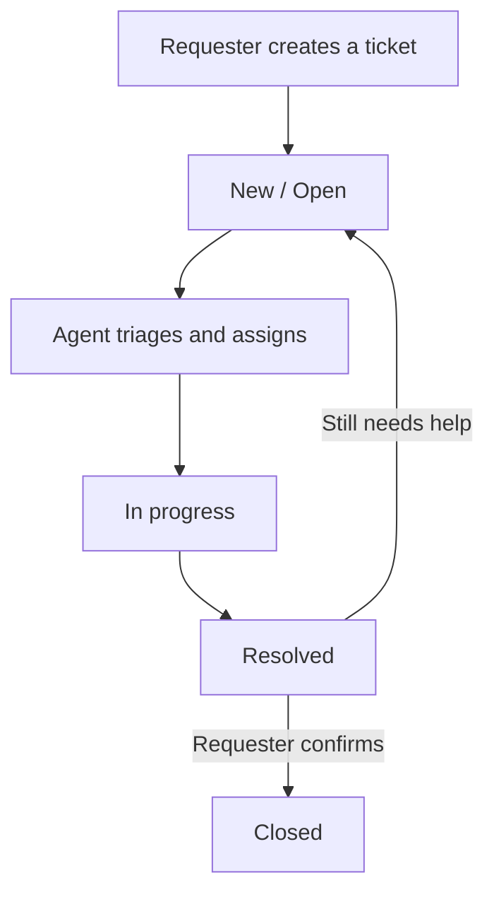
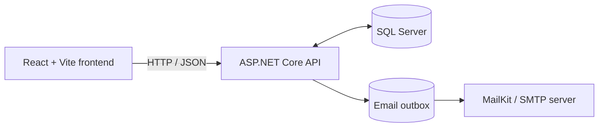

<h1 align="center">
  
</h1>

<p align="center">
  <strong>A full-stack support workspace for creating, tracking, assigning, and resolving help-desk requests.</strong>
</p>

<p align="center">
  
  
  
  
  
</p>

<p align="center">
  <a href="#-product-tour">Product tour</a> ·
  <a href="#-features">Features</a> ·
  <a href="#-getting-started">Getting started</a> ·
  <a href="#-api-overview">API overview</a>
</p>

## 🚀 Product tour

The looping slideshow below is assembled from the supplied website recording. It rotates through the workspace overview, ticket inbox, team and access controls, and the ticket creation form.

<p align="center">
  
</p>

<details>
  <summary><strong>View individual screenshots</strong></summary>
  <br />
  <table>
    <tr>
      <td align="center" width="50%">
        <strong>Workspace overview</strong><br />
        <a href="docs/readme-assets/screenshots/overview.png"></a>
      </td>
      <td align="center" width="50%">
        <strong>Ticket inbox</strong><br />
        <a href="docs/readme-assets/screenshots/ticket-inbox.png"></a>
      </td>
    </tr>
    <tr>
      <td align="center" width="50%">
        <strong>Team and access</strong><br />
        <a href="docs/readme-assets/screenshots/team-access.png"></a>
      </td>
      <td align="center" width="50%">
        <strong>Raise a ticket</strong><br />
        <a href="docs/readme-assets/screenshots/raise-ticket.png"></a>
      </td>
    </tr>
  </table>
</details>

## 🪐 Overview

**ORBITDESK** is a full-stack help-desk and ticketing application that brings support requests into one workspace. Requesters can raise issues and follow their progress, support agents can triage and work the queue, and administrators can manage workspace roles.

The repository contains a React frontend, an ASP.NET Core Web API, SQL Server persistence, and a Docker Compose setup for local development.

## ✨ Features

- **Ticket lifecycle management:** Create tickets with a title, description, category, and priority. Track statuses from `New` and `Open` through `InProgress` and `Resolved` to `Closed`.
- **Search and triage:** Search tickets by text and filter by status or priority. The dashboard summarizes queue totals and highlights tickets that need attention.
- **Ticket conversations and history:** Add replies, distinguish internal support comments from requester-visible comments, and review the ticket's change history.
- **Assignment and status controls:** Agents and administrators can assign tickets and update their progress.
- **Requester-confirmed closure:** A resolved ticket is not considered closed until the requester confirms the fix. If the issue remains, the requester can ask for more help and reopen it.
- **Role-based workspace access:** Separate `User`, `Agent`, and `Admin` roles. Administrators can review members and change roles.
- **Authentication and validation:** JWT bearer authentication, server-side role checks, password policy enforcement, and request validation.
- **Email notification outbox:** Ticket-related email notifications are queued and delivered through MailKit when SMTP is configured.
- **Account controls:** Supported requester accounts can be deleted with password confirmation; related ticket and audit records are retained consistently.
- **Containerized local setup:** Docker Compose starts SQL Server, the API, and the web frontend.

## 🧭 Ticket workflow



The API records status and assignment changes in ticket history. Email delivery is optional for local use; without SMTP configuration, messages remain queued in the outbox.

## 🧰 Tech stack

| Layer | Technologies |
|---|---|
| Frontend | React 19, TypeScript, Vite, TanStack Query, Lucide React |
| Backend | ASP.NET Core Web API on .NET 10, Entity Framework Core, ASP.NET Core Identity, JWT bearer authentication |
| Validation and logging | FluentValidation, Serilog |
| Database | Microsoft SQL Server 2022 |
| Email | MailKit and a background outbox worker |
| Local orchestration | Docker Compose, Nginx |
| CI | GitHub Actions for backend tests and frontend build validation |

### Architecture at a glance



## ⚙️ Getting started

### Option 1: Run the complete stack with Docker Compose

**Prerequisites:** Docker Desktop or Docker Engine with the Compose plugin. Ensure ports `3000`, `5080`, and `1433` are available.

1. **Clone the repository** and open its root directory.

   ```bash
   git clone https://github.com/Sai-Srinivas-P/ORBITDESK-HELP-DESK-AND-TICKETING-SYSTEM.git
   cd ORBITDESK-HELP-DESK-AND-TICKETING-SYSTEM
   ```

2. **Create your local environment file.**

   macOS / Linux:
   ```bash
   cp .env.example .env
   ```

   Windows PowerShell:
   ```powershell
   Copy-Item .env.example .env
   ```

3. **Edit `.env` before starting the stack.** Set your own values for `SA_PASSWORD`, `JWT_KEY`, `ADMIN_EMAIL`, `ADMIN_PASSWORD`, `AGENT_EMAIL`, and `AGENT_PASSWORD`. Use a strong SQL Server password and a JWT signing key of at least 32 bytes. The values in `.env.example` are local-development placeholders, not production credentials.

4. **Build and start the services.**

   ```bash
   docker compose up --build -d
   ```

5. **Open the application.**

   | Service | Local address |
   |---|---|
   | OrbitDesk web app | [http://localhost:3000](http://localhost:3000) |
   | API | [http://localhost:5080](http://localhost:5080) |
   | API health check | [http://localhost:5080/health](http://localhost:5080/health) |
   | SQL Server | `localhost:1433` |

The API creates the local database schema and seeds the `Admin`, `Agent`, and `User` roles during startup. The administrator and agent accounts are provisioned from the seed values in your environment configuration. On the sign-in screen, choose **Admin** for the configured administrator account; requesters and agents use **User** sign-in.

Useful Docker commands:

```bash
# Follow API logs
docker compose logs -f api

# Show running services
docker compose ps

# Stop services (keeps the named database volume)
docker compose down
```

> **Database note:** `docker compose down -v` also deletes the local SQL Server data volume. Use it only when you intend to discard the development database.

### Optional email configuration

SMTP is not required to launch the app. To deliver queued notifications, configure these values in `.env` and restart the API service:

| Variable | Purpose |
|---|---|
| `SMTP_HOST` | SMTP server host |
| `SMTP_PORT` | SMTP server port |
| `SMTP_USE_SSL` | Whether to use SSL/TLS for the SMTP connection |
| `SMTP_USERNAME` / `SMTP_PASSWORD` | SMTP credentials, if required |
| `SMTP_FROM_EMAIL` / `SMTP_FROM_NAME` | Sender address and display name |

Keep real mail credentials and other secrets out of source control.

### Option 2: Run the frontend in development mode

Use this when the API is already available at `http://localhost:5080` and you want Vite's development server and hot reload.

```bash
cd frontend
npm ci
npm run dev
```

Open [http://localhost:5173](http://localhost:5173). Vite proxies `/api` and `/health` requests to `http://localhost:5080`.

### Run the backend outside Docker

Install the .NET 10 SDK and make sure a SQL Server instance is reachable. Configure the API's `ConnectionStrings:DefaultConnection`, `Jwt:Key`, and seed account settings using ASP.NET Core configuration or user secrets, then run:

```bash
cd backend
dotnet restore HelpDesk.sln
dotnet run --project src/HelpDesk.Api
```

The `.env` file is read by Docker Compose; a plain `dotnet run` does not automatically load it. Do not reuse local placeholder credentials in a deployed environment.

## 🔌 API overview

The API is rooted at `/api`. Authenticated endpoints enforce role and requester-ownership checks where applicable.

| Method | Endpoint | Purpose |
|---|---|---|
| `POST` | `/api/auth/register` | Register a requester account |
| `POST` | `/api/auth/login` | Sign in and receive a JWT |
| `GET` | `/api/auth/me` | Get the current account |
| `DELETE` | `/api/auth/me` | Delete the current account after confirmation |
| `GET` | `/api/tickets` | List tickets; supports search, status, and priority filters |
| `GET` | `/api/tickets/summary` | Return dashboard and queue counts |
| `POST` | `/api/tickets` | Create a ticket |
| `GET` | `/api/tickets/{id}` | Retrieve ticket detail, comments, and history |
| `POST` | `/api/tickets/{id}/comments` | Add a ticket comment |
| `PATCH` | `/api/tickets/{id}/status` | Update status (Agent/Admin) |
| `POST` | `/api/tickets/{id}/closure-response` | Confirm resolution or request more help |
| `PUT` | `/api/tickets/{id}/assignee` | Assign a ticket (Agent/Admin) |
| `GET` | `/api/agents` | List eligible agents and admins (Agent/Admin) |
| `GET` | `/api/admin/users` | List workspace members (Admin) |
| `PUT` | `/api/admin/users/{id}/role` | Change a member's role (Admin) |
| `GET` | `/health` | Health-check endpoint |

In development mode, the API also exposes its OpenAPI document through ASP.NET Core's OpenAPI endpoint.

## 🗂️ Project structure

```text
ORBITDESK-HELP-DESK-AND-TICKETING-SYSTEM/
├── frontend/
│   ├── src/
│   │   ├── App.tsx                 # Main views and ticket interactions
│   │   ├── api.ts                  # Typed API client and session helpers
│   │   └── styles.css              # Application styles
│   │
│   ├── package.json
│   └── vite.config.ts
├── backend/
│   ├── src/HelpDesk.Api/
│   │   ├── Controllers/            # Auth, tickets, and admin endpoints
│   │   ├── Data/                   # Entity Framework Core context
│   │   ├── Models/                 # Users, tickets, comments, history, outbox
│   │   ├── Services/               # JWT, seed data, workflow, email worker
│   │   └── Validators/
│   ├── tests/HelpDesk.Api.Tests/
│   └── HelpDesk.sln
├── docs/readme-assets/              # README graphics and recorded UI previews
├── docker-compose.yml
├── .env.example
└── README.md
```

## 🧪 Build and test

Run the same core checks locally:

```bash
# Backend test suite
cd backend
dotnet restore HelpDesk.sln
dotnet test HelpDesk.sln --configuration Release

# Frontend type-check and production build
cd ../frontend
npm ci
npm run build
```

GitHub Actions runs the backend tests and frontend build on pushes and pull requests.

## 🔐 Security and deployment notes

- Never commit `.env` or real credentials. Use environment variables or a secret manager for deployed environments.
- Replace development JWT keys, seed account passwords, and database passwords before sharing or deploying an instance.
- Configure HTTPS, trusted origins, SMTP, database backups, and an appropriate schema-migration process before production use.
- The supplied Compose configuration is intended as a local development starting point; review its ports and development settings before exposing services publicly.

## 🤝 Contributing

Bug reports, improvements, and pull requests are welcome. For meaningful changes, describe the behavior being changed and include the relevant test or verification steps. Please avoid including secrets, real customer data, or private ticket contents in issues and screenshots.

## 📄 License

Distributed under the MIT License. See [`LICENSE`](LICENSE) for details.

<p align="center">
  <em>Keep every request in orbit. Make every resolution count. ✦</em>
</p>
