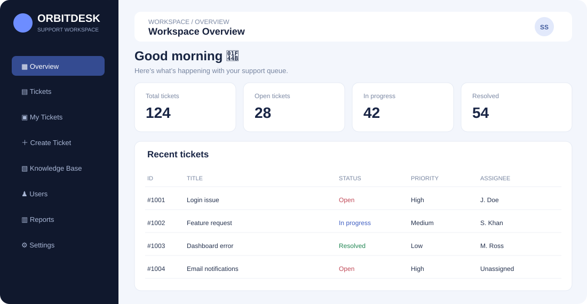
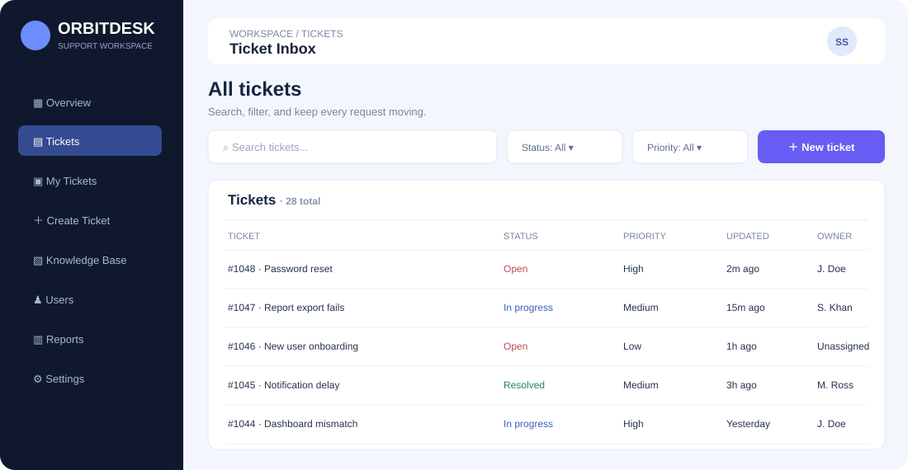
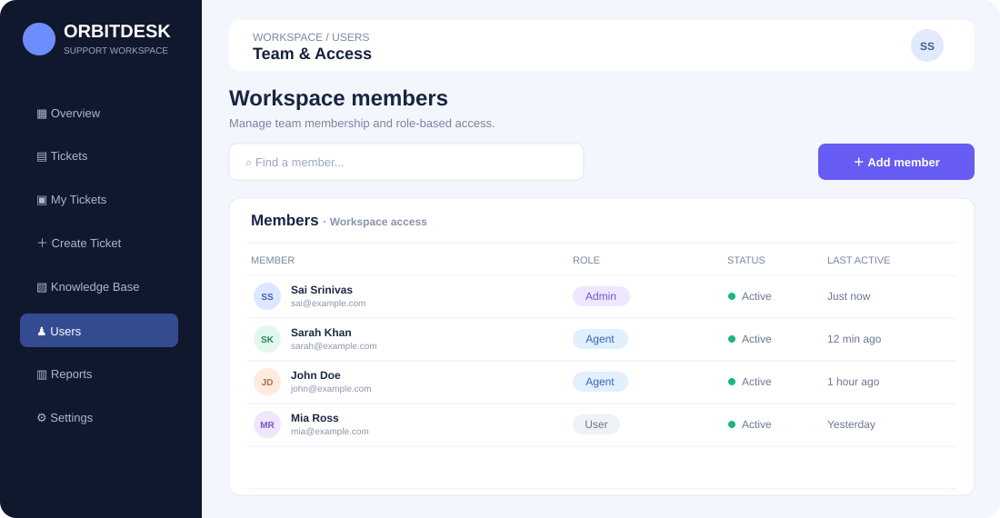
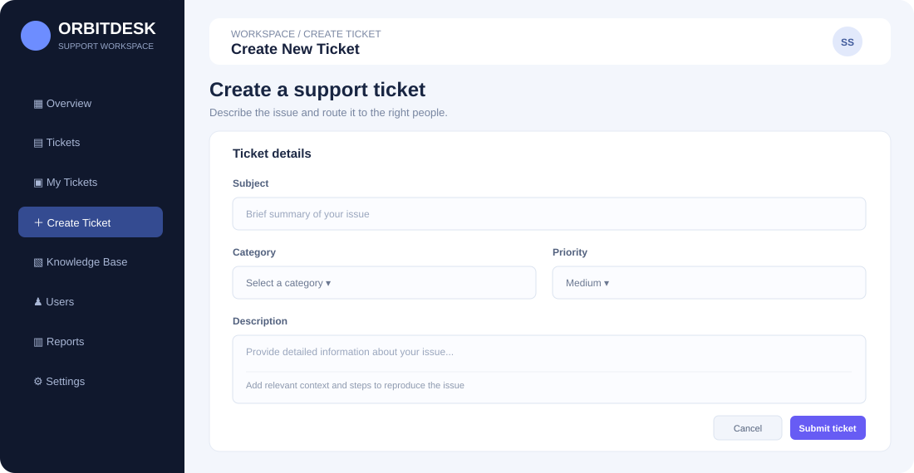
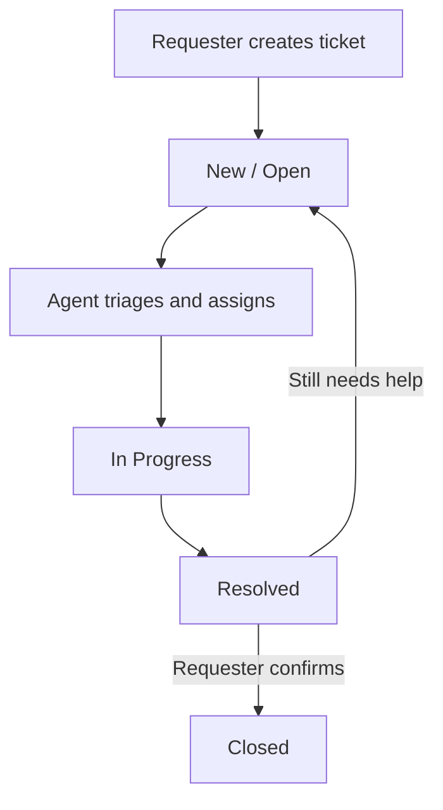
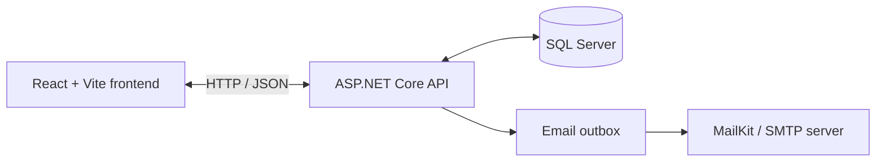

<p align="center">
  
</p>

<p align="center">
  <strong>A full-stack support workspace to create, assign, track, and resolve tickets.</strong>
</p>

<p align="center">
  
  
  
  
  <a href="LICENSE"></a>
</p>

<p align="center">
  <a href="#-website-tour">Website tour</a> ·
  <a href="#-features">Features</a> ·
  <a href="#-getting-started">Getting started</a> ·
  <a href="#-api-overview">API overview</a>
</p>

## 🌌 Overview

**ORBITDESK** is a help desk and ticketing application for organizing support requests in one workspace. Requesters can raise issues and follow their progress, support agents can triage and resolve tickets, and administrators can manage workspace roles.

This repository contains a React frontend, an ASP.NET Core Web API, SQL Server persistence, and Docker Compose configuration for local development.

## 🎬 Website tour

The automatically cycling SVG preview below is designed from the page layouts in the supplied website recording. It highlights the dashboard, ticket inbox, team access, and ticket creation views.

<p align="center">
  
</p>

### Page previews

These lightweight illustrations are based on the interface shown in the recording and are stored directly in this repository, so they render without external image hosting.

| Workspace overview | Ticket inbox |
|---|---|
|  |  |

| Team and access | Raise a ticket |
|---|---|
|  |  |

## ✨ Features

- **Ticket lifecycle management:** Create support requests and track their status from New/Open through In Progress, Resolved, and Closed.
- **Search and triage:** Search tickets and filter by status or priority.
- **Ticket conversations and history:** Add comments and review ticket changes.
- **Assignment and workflow controls:** Agents and administrators can assign tickets and update progress.
- **Requester-confirmed closure:** Requesters can confirm a resolution or ask for more help.
- **Role-based access:** Separate User, Agent, and Admin roles.
- **Authentication and validation:** JWT bearer authentication, server-side role checks, and request validation.
- **Email notifications:** Notification outbox with optional SMTP delivery through MailKit.
- **Containerized development:** Docker Compose starts the frontend, API, and SQL Server.

## 🧭 Ticket workflow



The API records status and assignment changes in ticket history. Email delivery is optional for local development; without SMTP configuration, messages remain queued in the outbox.

## 🧰 Technology stack

| Layer | Technologies |
|---|---|
| Frontend | React 19, TypeScript, Vite, TanStack Query, Lucide React |
| Backend | ASP.NET Core Web API on .NET 10 |
| Authentication | ASP.NET Core Identity, JWT bearer authentication |
| Data access | Entity Framework Core |
| Database | Microsoft SQL Server 2022 |
| Validation and logging | FluentValidation, Serilog |
| Email | MailKit and a background outbox worker |
| Local orchestration | Docker Compose, Nginx |
| CI | GitHub Actions |

### Architecture at a glance



## ⚙️ Getting started

### Option 1: Run the complete stack with Docker Compose

**Prerequisites:** Docker Desktop or Docker Engine with the Compose plugin. Ensure ports `3000`, `5080`, and `1433` are available.

1. Clone the repository:

   ```bash
   git clone https://github.com/Sai-Srinivas-P/ORBITDESK-HELP-DESK-AND-TICKETING-SYSTEM.git
   cd ORBITDESK-HELP-DESK-AND-TICKETING-SYSTEM
   ```

2. Create a local environment file:

   macOS / Linux:
   ```bash
   cp .env.example .env
   ```

   Windows PowerShell:
   ```powershell
   Copy-Item .env.example .env
   ```

3. Edit `.env`. Replace the local placeholder values for `SA_PASSWORD`, `JWT_KEY`, `ADMIN_PASSWORD`, and `AGENT_PASSWORD` with your own development secrets. Use a strong database password and a JWT signing key of at least 32 bytes. Never use development placeholders in production.

4. Build and start the services:

   ```bash
   docker compose up --build -d
   ```

5. Open the application:

   | Service | Local address |
   |---|---|
   | Web app | [http://localhost:3000](http://localhost:3000) |
   | API | [http://localhost:5080](http://localhost:5080) |
   | Health check | [http://localhost:5080/health](http://localhost:5080/health) |
   | SQL Server | `localhost:1433` |

The API creates the local database schema and seeds development roles and accounts from your environment configuration.

Useful commands:

```bash
docker compose ps
docker compose logs -f api
docker compose down
```

> **Database note:** `docker compose down -v` also deletes the named SQL Server data volume. Use it only when you intend to discard local database data.

### Optional email configuration

SMTP is not required to launch the app. To deliver queued notifications, configure these values in `.env` and restart the API service.

| Variable | Purpose |
|---|---|
| `SMTP_HOST` | SMTP server hostname |
| `SMTP_PORT` | SMTP port |
| `SMTP_USE_SSL` | Whether SSL/TLS is enabled |
| `SMTP_USERNAME`, `SMTP_PASSWORD` | SMTP credentials, if required |
| `SMTP_FROM_EMAIL`, `SMTP_FROM_NAME` | Sender address and display name |

Keep real email credentials and other secrets out of source control.

### Option 2: Run the frontend in development mode

Use this option if the API is already running at `http://localhost:5080`.

```bash
cd frontend
npm ci
npm run dev
```

Open [http://localhost:5173](http://localhost:5173). Vite proxies `/api` and `/health` requests to the API.

### Run the backend outside Docker

Install the .NET 10 SDK and make sure a SQL Server instance is reachable. Configure the connection string, JWT key, and seed-account settings using ASP.NET Core configuration or user secrets, then run:

```bash
cd backend
dotnet restore HelpDesk.sln
dotnet run --project src/HelpDesk.Api
```

The `.env` file is read by Docker Compose; a plain `dotnet run` does not automatically load it. Do not use local placeholder credentials in a deployed environment.

## 🔌 API overview

The API is rooted at `/api`. Authenticated endpoints enforce role and requester-ownership checks where applicable.

| Method | Endpoint | Purpose |
|---|---|---|
| `POST` | `/api/auth/register` | Register a requester account |
| `POST` | `/api/auth/login` | Sign in and receive a JWT |
| `GET` | `/api/auth/me` | Get the current account |
| `DELETE` | `/api/auth/me` | Delete the current account after confirmation |
| `GET` | `/api/tickets` | List tickets; supports search and filters |
| `GET` | `/api/tickets/summary` | Return dashboard and queue counts |
| `POST` | `/api/tickets` | Create a ticket |
| `GET` | `/api/tickets/{id}` | Retrieve ticket detail, comments, and history |
| `POST` | `/api/tickets/{id}/comments` | Add a ticket comment |
| `PATCH` | `/api/tickets/{id}/status` | Update status (Agent/Admin) |
| `POST` | `/api/tickets/{id}/closure-response` | Confirm resolution or request more help |
| `PUT` | `/api/tickets/{id}/assignee` | Assign a ticket (Agent/Admin) |
| `GET` | `/api/agents` | List eligible agents and admins |
| `GET` | `/api/admin/users` | List workspace members (Admin) |
| `PUT` | `/api/admin/users/{id}/role` | Change a member's role (Admin) |
| `GET` | `/health` | Health-check endpoint |

## 🗂️ Project structure

```text
ORBITDESK-HELP-DESK-AND-TICKETING-SYSTEM/
├── frontend/
│   ├── src/
│   │   ├── App.tsx
│   │   ├── api.ts
│   │   └── styles.css
│   └── package.json
├── backend/
│   ├── src/HelpDesk.Api/
│   │   ├── Controllers/
│   │   ├── Data/
│   │   ├── Models/
│   │   ├── Services/
│   │   └── Validators/
│   ├── tests/HelpDesk.Api.Tests/
│   └── HelpDesk.sln
├── docs/readme-assets/              # README visuals and page previews
├── docker-compose.yml
├── .env.example
└── README.md
```

## 🧪 Build and test

Backend tests:

```bash
cd backend
dotnet restore HelpDesk.sln
dotnet test HelpDesk.sln --configuration Release
```

Frontend type-check and production build:

```bash
cd frontend
npm ci
npm run build
```

GitHub Actions runs the backend tests and frontend build on pushes and pull requests.

## 🔐 Security notes

- Never commit `.env`, passwords, signing keys, or real SMTP credentials.
- Change development seed passwords and keys before deployment.
- Configure HTTPS, trusted origins, database backups, and a suitable schema-migration process before production.
- Review development ports and settings before exposing services publicly.

## 🤝 Contributing

Bug reports and pull requests are welcome. Include reproduction steps and relevant verification results. Do not post secrets, customer data, or private ticket details in issues and screenshots.

## 📄 License

Distributed under the MIT License. See [LICENSE](LICENSE).

<p align="center"><strong>Keep every request in orbit. Make every resolution count. ✦</strong></p>
