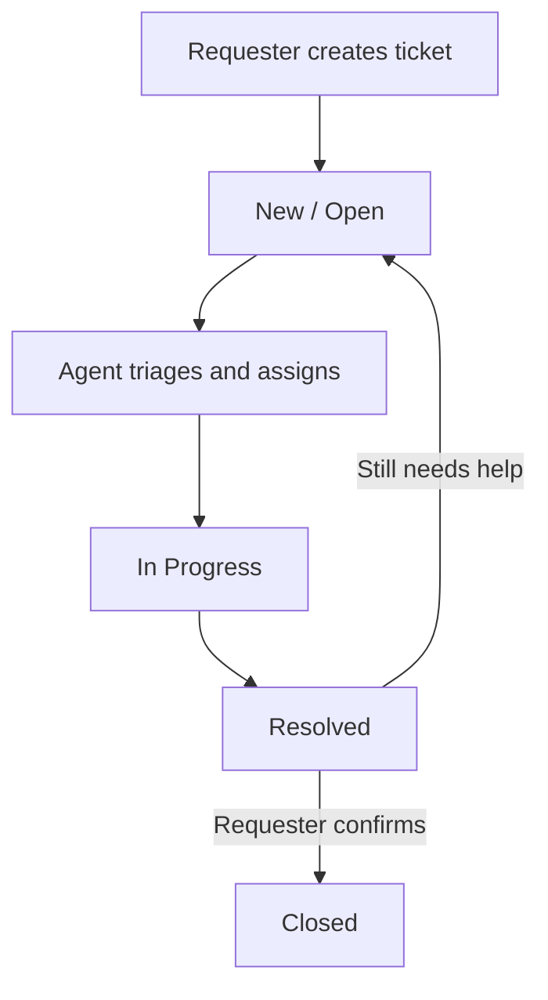
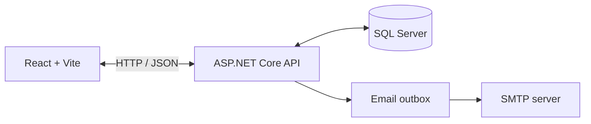

<div align="center">

# 🌌 ORBITDESK

### Help Desk & Ticketing System

**A full-stack support workspace to create, assign, track, and resolve tickets.**

[](https://react.dev/)
[](https://www.typescriptlang.org/)
[](https://dotnet.microsoft.com/)
[](https://www.microsoft.com/sql-server)
[](LICENSE)

**Support. Manage. Resolve. Together.** 🚀

</div>

---

## 🛰️ Explore ORBITDESK

A help desk application for organizing support requests in one place. Requesters can raise issues and track progress, agents can triage and resolve tickets, and administrators can manage workspace members and roles.

## 🎬 Website preview

The screens below are taken from the supplied ORBITDESK website recording.

| Workspace overview | Ticket inbox |
|---|---|
|  |  |

| Team and access | Raise a ticket |
|---|---|
|  |  |

> **Animated tour:** A GIF slideshow of the pages will be added after the image assets are uploaded to the repository. GitHub README images must be committed to the repository or hosted at a publicly accessible URL.

## ✨ Features

- **Ticket lifecycle:** Create and track tickets through New, Open, In Progress, Resolved, and Closed states.
- **Search and triage:** Search tickets and filter by status or priority.
- **Ticket conversations and history:** Add comments and review ticket changes.
- **Assignment controls:** Agents and administrators can assign tickets and update progress.
- **Requester-confirmed closure:** Requesters can confirm a resolution or ask for further help.
- **Role-based access:** Separate User, Agent, and Admin roles.
- **Authentication and validation:** JWT bearer authentication, server-side authorization, and request validation.
- **Email notifications:** Notification outbox with optional SMTP delivery through MailKit.
- **Docker Compose:** Start the frontend, API, and SQL Server together for local development.

## 🧭 Ticket workflow



## 🧰 Technology stack

| Layer | Technologies |
|---|---|
| Frontend | React 19, TypeScript, Vite, TanStack Query, Lucide React |
| Backend | ASP.NET Core Web API, .NET 10 |
| Authentication | ASP.NET Core Identity, JWT bearer authentication |
| Data access | Entity Framework Core |
| Database | Microsoft SQL Server 2022 |
| Validation and logs | FluentValidation, Serilog |
| Email | MailKit and a background outbox worker |
| Local orchestration | Docker Compose, Nginx |
| CI | GitHub Actions |

### Architecture



## ⚙️ Getting started

### Option 1: Run the complete stack with Docker Compose

**Prerequisites:** Docker Desktop or Docker Engine with the Compose plugin. Ports `3000`, `5080`, and `1433` should be available.

1. Clone the repository:

   ```bash
   git clone https://github.com/Sai-Srinivas-P/ORBITDESK-HELP-DESK-AND-TICKETING-SYSTEM.git
   cd ORBITDESK-HELP-DESK-AND-TICKETING-SYSTEM
   ```

2. Create a local environment file:

   macOS / Linux:
   ```bash
   cp .env.example .env
   ```

   Windows PowerShell:
   ```powershell
   Copy-Item .env.example .env
   ```

3. Edit `.env`. Replace the local placeholder values for `SA_PASSWORD`, `JWT_KEY`, `ADMIN_PASSWORD`, and `AGENT_PASSWORD` with your own development secrets. Use a strong database password and a JWT key of at least 32 bytes. Never use development placeholders in production.

4. Build and start:

   ```bash
   docker compose up --build -d
   ```

5. Open the app:

   | Service | URL |
   |---|---|
   | Web app | [http://localhost:3000](http://localhost:3000) |
   | API | [http://localhost:5080](http://localhost:5080) |
   | Health check | [http://localhost:5080/health](http://localhost:5080/health) |
   | SQL Server | `localhost:1433` |

The API initializes the development database and seeds role/account data from the environment settings.

Useful commands:

```bash
docker compose ps
docker compose logs -f api
docker compose down
```

> **Note:** `docker compose down -v` deletes the named SQL Server data volume as well. Use it only when you intend to remove local database data.

### Optional SMTP configuration

SMTP is not required to run the app. To enable outbound email, configure the relevant variables in `.env` and restart the API service.

| Variable | Purpose |
|---|---|
| `SMTP_HOST` | SMTP server hostname |
| `SMTP_PORT` | SMTP port |
| `SMTP_USE_SSL` | Whether SSL/TLS is enabled |
| `SMTP_USERNAME`, `SMTP_PASSWORD` | SMTP credentials, if required |
| `SMTP_FROM_EMAIL`, `SMTP_FROM_NAME` | Sender details |

### Option 2: Run the frontend in development mode

Use this if the API is already running at `http://localhost:5080`.

```bash
cd frontend
npm ci
npm run dev
```

Open [http://localhost:5173](http://localhost:5173). Vite proxies `/api` and `/health` to the API.

### Run the backend outside Docker

Install the .NET 10 SDK and ensure a SQL Server instance is available. Configure the connection string, JWT key, and seed-account settings using ASP.NET Core configuration or user secrets. Then run:

```bash
cd backend
dotnet restore HelpDesk.sln
dotnet run --project src/HelpDesk.Api
```

Docker Compose reads `.env`; a plain `dotnet run` does not automatically load it.

## 🔌 API overview

The API is rooted at `/api`. Authenticated endpoints apply role and ownership checks where appropriate.

| Method | Endpoint | Purpose |
|---|---|---|
| `POST` | `/api/auth/register` | Register a requester |
| `POST` | `/api/auth/login` | Sign in and receive a JWT |
| `GET` | `/api/auth/me` | Get current account |
| `DELETE` | `/api/auth/me` | Delete current account after confirmation |
| `GET` | `/api/tickets` | List and filter tickets |
| `GET` | `/api/tickets/summary` | Dashboard summary |
| `POST` | `/api/tickets` | Create a ticket |
| `GET` | `/api/tickets/{id}` | Ticket detail, comments, and history |
| `POST` | `/api/tickets/{id}/comments` | Add a comment |
| `PATCH` | `/api/tickets/{id}/status` | Update status (Agent/Admin) |
| `POST` | `/api/tickets/{id}/closure-response` | Confirm resolution or request more help |
| `PUT` | `/api/tickets/{id}/assignee` | Assign ticket (Agent/Admin) |
| `GET` | `/api/agents` | List eligible agents and admins |
| `GET` | `/api/admin/users` | List workspace members (Admin) |
| `PUT` | `/api/admin/users/{id}/role` | Change member role (Admin) |
| `GET` | `/health` | Health check |

## 🗂️ Project structure

```text
ORBITDESK-HELP-DESK-AND-TICKETING-SYSTEM/
├── frontend/
│   ├── src/
│   │   ├── App.tsx
│   │   ├── api.ts
│   │   └── styles.css
│   └── package.json
├── backend/
│   ├── src/HelpDesk.Api/
│   │   ├── Controllers/
│   │   ├── Data/
│   │   ├── Models/
│   │   ├── Services/
│   │   └── Validators/
│   ├── tests/HelpDesk.Api.Tests/
│   └── HelpDesk.sln
├── docker-compose.yml
├── .env.example
└── README.md
```

## 🧪 Build and test

Backend tests:

```bash
cd backend
dotnet restore HelpDesk.sln
dotnet test HelpDesk.sln --configuration Release
```

Frontend type-check and production build:

```bash
cd frontend
npm ci
npm run build
```

## 🔐 Security notes

- Never commit `.env`, passwords, signing keys, or real SMTP credentials.
- Change all development seed passwords and keys before deployment.
- Configure HTTPS, trusted origins, database backups, and an appropriate schema-migration process before production.
- Review development ports and settings before exposing services publicly.

## 🤝 Contributing

Bug reports and pull requests are welcome. Include useful reproduction steps and relevant test results. Do not post secrets, customer data, or private ticket details in issues or screenshots.

## 📄 License

Distributed under the MIT License. See [LICENSE](LICENSE).

<div align="center">

**Keep every request in orbit. Make every resolution count.** ✦

</div>
